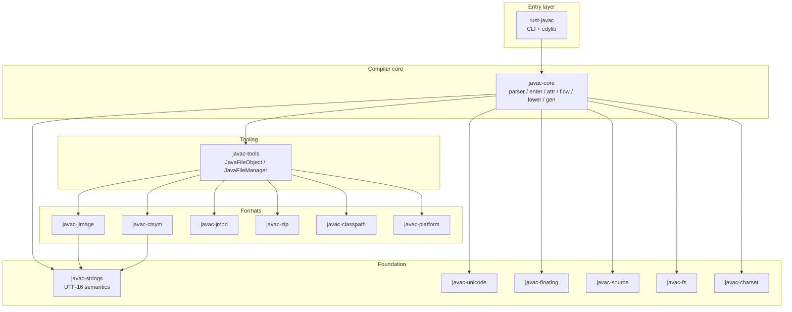
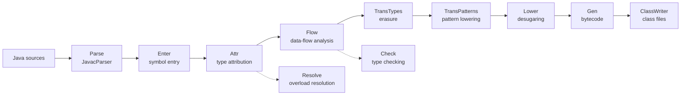
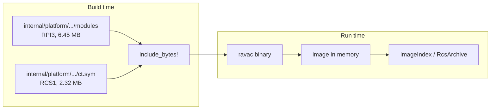
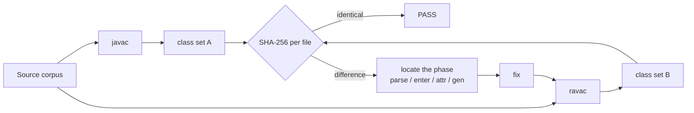

# Rust-Javac: An Equivalence Study of a Rust Reimplementation of javac

**English** | [简体中文](README.zh.md)

**Abstract.** This document describes `rust-javac`, a from-scratch Rust
reimplementation of the JDK 17 `javac`. The goal is not "it can compile Java"
but **byte-for-byte equivalence with the reference compiler**: identical class
file SHA-256, identical diagnostic text and positions, identical exit codes.
The system spans 15 crates and 326,445 lines of Rust. On 13 real-world project
corpora and on the JDK's own `java.base` it is verified as follows: all 3,066
class files of `java.base` are byte-identical, and Gson is 208/208. A full
`java.base` compile takes 23.25 s, 14% faster than Temurin's `javac` at 27.10 s.
The platform data (`modules` and `ct.sym`) is compiled into the binary, so the
artifact is a single self-contained file with no runtime dependencies.

---

## 1. Introduction

### 1.1 Motivation

`javac` is one of the largest and most tightly coupled tools in OpenJDK: about
300,000 lines of Java crossing parsing, symbol entry, type attribution, flow
analysis, erasure, pattern lowering and bytecode generation. It serves two
roles at once — the **reference implementation of the language semantics** and
the producer of **auditable compilation artifacts**.

Reimplementing it in another language is motivated by three things:

1. **Auditability.** Every Rust function points back to a specific class and
   line of `javac`, so behavioral differences can be located in the mapping.
2. **Performance.** The Java implementation pays for JVM startup, GC and object
   headers; the Rust implementation can reorganize the hot data structures.
3. **Deployment.** A single binary, no JRE required.

### 1.2 Contributions

- **Equivalence, not compatibility.** The target is not "runs" but "produces
  the same bytes". Verification runs both compilers over the same corpus and
  compares `SHA-256` per class file.
- **A line-by-line porting methodology.** The Rust code keeps `javac`'s file,
  class and method names plus line-number references, so the two
  implementations can be reviewed side by side.
- **Embedded platform data.** `modules` (6.45 MB) and `ct.sym` (2.32 MB) are
  compiled into the binary with `include_bytes!`; at run time they are read
  from memory.
- **A C ABI.** The same driver ships as both a CLI and a shared library
  (`ravac_compile(argc, argv)`); the Android/Linux packages include
  `libravac.so`.

---

## 2. Architecture

### 2.1 Crate layers

The system is layered by distance from Java semantics; lower layers never
depend on upper ones:



**Key design decision:** `javac-strings` represents a Java string as
`Arc<Vec<u16>>`, because `String.length()`, `charAt()`, modified UTF-8 encoding
and source positions in Java are all counted in **UTF-16 code units**.

### 2.2 Compilation pipeline

One-to-one with `javac`'s phases; each phase is a separate traversal:



All phase state lives in arenas inside `CompilerContext`:

```rust
pub struct CompilerContext {
    pub symbols: Arena<Symbol>,
    pub types: Arena<Type>,
    pub trees: Arena<JCTree>,
    pub scopes: Arena<Scope>,
    pub attributes: Arena<Attribute>,
    pub directives: Arena<Directive>,
}
```

Objects reference each other through `SymbolId` / `TypeId` / `TreeId` rather
than `Rc`. This is both a performance choice and what turns the "object graph"
into flat, indexable arrays.

### 2.3 Platform data lifecycle

`javac` reads the JDK's `lib/modules` through the `jrt:` file system and
provides the `--release` view through `ct.sym`. This implementation compiles
both into the binary:



A single `Source` enum unifies file and in-memory reads:

```rust
pub enum Source {
    File(File),
    Bytes(&'static [u8]),
}
```

---

## 3. Method

### 3.1 Line-by-line porting

The Rust code keeps `javac`'s source path, class name and method name, and the
doc comment records the corresponding line numbers:

```rust
/// Java: public void visitClassDef(JCClassDecl tree) (MemberEnter.java:113-190)
pub fn visit_class_def(&mut self, tree: TreeId) { ... }
```

This has three consequences:

- **Auditable:** any behavior can be compared across the two implementations.
- **Verifiable:** a difference can be located to a phase.
- **Costly:** the data structures cannot be refactored freely, or the line
  mapping breaks.

### 3.2 Adapters

The semantic gaps between Java and Rust are concentrated in a few places,
marked with explicit "PORTING ADAPTER" comments:

| Gap | Adaptation |
|---|---|
| `String` is UTF-16 | `JavaString` (`Arc<Vec<u16>>`) |
| `java.nio.file.Path` | `javac-fs::Path` (keeps Windows drive/UNC semantics) |
| `IOException` | `javac_core::Error` + `Result` |
| `null` | `Option<T>` |
| Shared mutable state (`javac`'s service objects) | `Rc<RefCell<...>>` |

### 3.3 Determinism and output

Byte-identical class files depend on:

1. **Constant-pool order.** `PoolWriter` assigns indices in `javac`'s insertion
   order.
2. **Attribute order.** `ClassWriter` writes `Code`, `LineNumberTable` and
   `StackMapTable` in a fixed order.
3. **Hash iteration order.** No default randomized `HashMap` seed; the code
   uses `FxBuildHasher`.

---

## 4. Evaluation

### 4.1 Correctness

For each corpus, both Temurin `javac` and this implementation run, and every
produced `class` file is compared by `SHA-256`:

| Corpus | Files | Byte-identical |
|---|---:|---:|
| Gson 2.10.1 | 208 | 208 |
| `java.base` | 3,066 | 3,066 |
| `java.sql` | 76 | 76 |
| `java.xml` | 1,856 | 1,856 |
| Guava, OkHttp, RxJava, commons-lang3, JUnit 5, Spring | — | all identical |

In addition:

- **602 langtools diagnostic samples** match line by line (text, position,
  count, order);
- **43 Java 9–17 language-feature units** pass;
- **1,007 unit tests**.

> These are sampled results over fixed corpora and fixed options; they do not
> claim equivalence for arbitrary programs.

### 4.2 Performance

Full `java.base` (3,066 source files), same machine, same corpus:

| Implementation | Wall clock | Relative to javac |
|---|---:|---:|
| Temurin javac 17.0.19 | 27.10 s | 1.00× |
| rust-javac (system heap) | 29.54 s | 0.92× |
| rust-javac (mimalloc) | **23.25 s** | **1.17×** |

The allocator mattered far more than expected: Rust's default `HeapAlloc` is
27% slower than mimalloc on `java.base`. After switching, the profile moved
from "allocator" to the actual workload (`accept` traversal, constant-pool
lookups, `Scope::lookup`).

On smaller corpora, startup overhead weighs less:

| Corpus | javac | rust-javac | Ratio |
|---|---:|---:|---:|
| Gson (208 classes) | 2.57–3.09 s | 1.06–1.15 s | 2.4–2.7× |
| `java.sql` (76) | 1.84 s | 0.51 s | 3.6× |
| `java.xml` (1,856) | 18.11 s | 14.91 s | 1.2× |

### 4.3 Verification loop



---

## 5. Reproduction

### 5.1 Environment

**Required**

| Dependency | Notes |
|---|---|
| Rust | `rust-toolchain.toml` pins `nightly-2026-11-01` (with `rustfmt`, `clippy`); `rustup` installs it on entering the repository |
| Platform data | Checked in: `internal/platform/17.0.19+10/{modules,ct.sym}` |
| Python 3 | Checkers and packaging scripts (`scripts/*.py`) |

**Windows (GNU target).** `mimalloc` is C, so a MinGW C compiler is required:

```powershell
winget install MartinStorsjo.LLVM-MinGW.UCRT
$env:CC_x86_64_pc_windows_gnu = "<LLVM-MinGW>\bin\clang.exe"
$env:AR_x86_64_pc_windows_gnu = "<LLVM-MinGW>\bin\llvm-ar.exe"
```

> ⚠️ Do not add that `bin` directory to `PATH`: its bundled
> `x86_64-w64-mingw32-gcc` shadows the Rust linker and produces
> `unable to find library -lgcc`, an error that points nowhere near the real
> cause.

**Reference testing (optional).** `scripts/check_*.py` need a JDK 17 as the
reference compiler:

```powershell
$env:JAVA_HOME = "C:\Program Files\Eclipse Adoptium\jdk-17.0.19.10-hotspot"
```

**Cross builds (optional)**

| Target | Extra dependency |
|---|---|
| `linux-amd64` / `linux-arm64` | `rustup target add x86_64-unknown-linux-musl aarch64-unknown-linux-musl`; linking uses Rust's bundled `rust-lld` |
| `android-arm64` | `rustup target add aarch64-linux-android` plus the Android NDK (`scripts/package.py` finds it automatically) |

### 5.2 Build

```powershell
cargo build -p rust-javac --release
target\release\ravac.exe -d out Hello.java
```

The artifact is a single file: the platform data is inside the binary, read
from memory at run time; no external file is read and `JAVA_HOME` / `PATH` are
never consulted. The Android/Linux packages additionally contain
`libravac.so`.

### 5.3 Testing

In increasing cost order:

```powershell
cargo test -p javac-core --lib        # L0: unit tests
py scripts/check_gson.py              # L1: Gson byte-identical (~3 s)
py scripts/check_java_base.py         # one module in full (3,066 files)
py scripts/gate.py --run              # picks a level from the changed paths (L0–L3)
```

Levels:

| Level | Contents | Time |
|---|---|---|
| L0 | unit tests | ~10 s |
| L1 | L0 + repro + Gson | ~15 s |
| L2 | L1 + jdk.compiler + Guava + OkHttp + RxJava + Spring | ~85 s |
| L3 | every test, corpus and module check | minutes |

### 5.4 Packaging

```powershell
py scripts/package.py --build --release --platforms all
py scripts/package.py --build --release --platforms android-arm64
```

The script discovers MinGW (winget install) and the NDK by itself and writes
`dist/ravac-<version>-<platform>.zip`.

---

## 6. Limitations

The following capabilities are **intentionally not implemented**; the command
line rejects them:

| Option | Reason |
|---|---|
| `-proc:*`, `-processor*`, `-A*` | `javax.annotation.processing` is not implemented |
| `--enable-preview` | preview class files are not guaranteed byte-identical |
| `-Xplugin`, `-Xdoclint`, `-Xprint` | not implemented |

Custom file managers and JVM stack-trace diagnostics (`-doe`) are also
unsupported.

More fundamental limitations:

- **Structural equivalence is not semantic equivalence.** Byte identity proves
  only "same output on these inputs with these options".
- **Line-by-line porting constrains optimization.** The layout of `ast` and
  `Symbol` must match `javac`'s access patterns, or the line mapping breaks.
- **The performance gain comes from the allocator, not the algorithm.**
  Release and debug timings are indistinguishable (29.54 s vs 29.37 s), which
  says the bottleneck is memory access rather than instruction count.

---

## 7. Related work and license

Other `javac` reimplementations (Eclipse ECJ, Kotlin's `kotlinc` JVM backend)
chose "compatibility over equivalence": they accept behavioral differences in
exchange for implementation freedom. This project makes the opposite trade —
**implementation freedom in exchange for verifiability**.

Reference implementation: jdk17u (Temurin 17.0.19+10).

License: GPL-2.0-only WITH Classpath-exception-2.0, see [LICENSE](LICENSE).

---

## Appendix: repository layout

```text
crates/
  javac-strings/     Java String UTF-16 semantics
  javac-unicode/     Unicode identifier rules
  javac-floating/    floating-point literals and IEEE 754
  javac-source/      SourceVersion / Target
  javac-fs/          java.nio.file.Path port
  javac-charset/     charsets
  javac-zip/         zip containers
  javac-jimage/      jimage (lib/modules)
  javac-ctsym/       ct.sym (RCS1)
  javac-jmod/        jmod
  javac-classpath/   classpath scanning
  javac-platform/    PlatformImage (jimage + RPI3)
  javac-tools/       JavaFileObject / JavaFileManager
  javac-core/        compiler proper
  rust-javac/        CLI + cdylib (ravac_compile)
internal/
  platform/          platform data (checked in)
  test/              corpora (13 projects + jdk-src)
scripts/             checkers, packaging, gate
```
