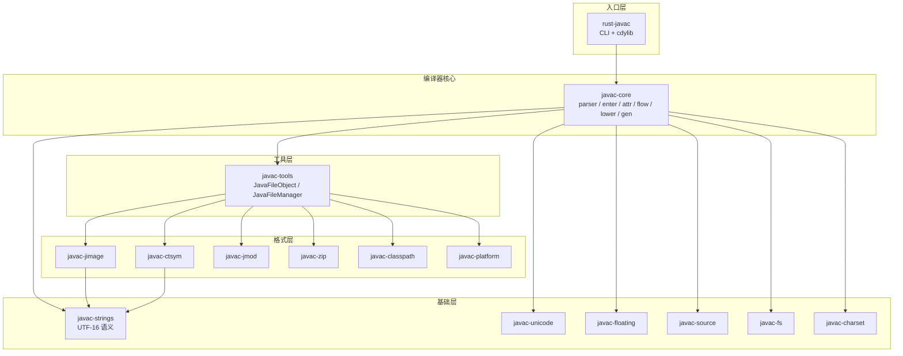
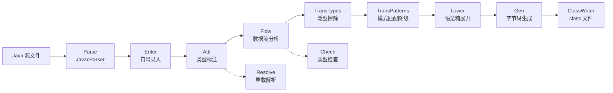
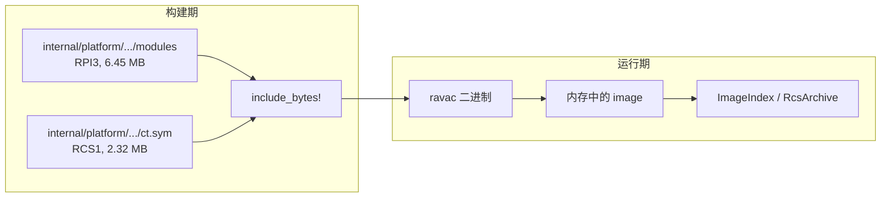
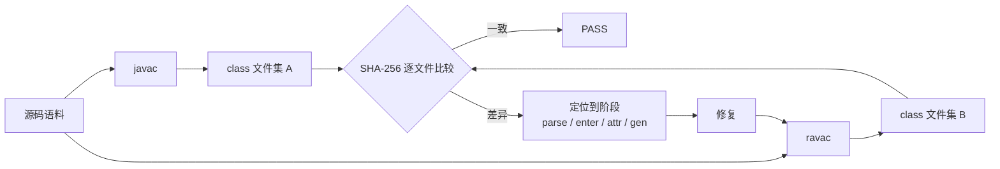

# Rust-Javac：用 Rust 重实现 javac 的等价性研究

[English](README.md) | **简体中文**

**摘要.** 本文描述 `rust-javac`——一个用 Rust 从零重写的 JDK 17 `javac`。目标不是"能编译 Java"，而是**与参考编译器逐字节等价**：class 文件 SHA-256 相同、诊断文本与位置相同、退出码相同。系统由 15 个 crate、326,445 行 Rust 构成，在 13 个真实项目语料与 JDK 自身的 `java.base` 上验证：3,066 个 class 文件全部字节一致，Gson 208/208 一致；`java.base` 全量编译 23.25 s，比 Temurin javac 的 27.10 s 快 14%。平台数据（`modules` 与 `ct.sym`）编译进二进制，产物是单文件，运行时零外部依赖。

---

## 1. 导言

### 1.1 动机

`javac` 是 OpenJDK 中体量最大、耦合最深的工具之一：约 30 万行 Java，横跨解析、符号录入、类型标注、流分析、泛型擦除、模式匹配降级与字节码生成。它同时承担两件事——**语言语义的参考实现**与**可审计的编译产物**。

用另一种语言重实现它，动机有三：

1. **可审计性**：每个 Rust 函数都能指回 `javac` 的某个类与行号，行为差异可以被定位到具体映射；
2. **性能**：Java 版本受 JVM 启动、GC 与对象头开销约束，Rust 版本可以用平坦内存布局重新组织热点数据结构；
3. **部署**：单文件二进制，不依赖 JRE。

### 1.2 贡献

- **等价性而非兼容性**：不追求"能跑"，追求**逐字节相同**。验证方式是对同一语料分别运行两个编译器，比较 `SHA-256`。
- **逐行移植方法论**：Rust 代码保留 `javac` 的文件名、类名、方法名与行号注释，便于交叉审阅。
- **平台数据嵌入**：`modules`（6.45 MB）与 `ct.sym`（2.32 MB）用 `include_bytes!` 编入二进制，运行时只读内存。
- **C ABI**：同一驱动同时导出为 CLI 与共享库（`ravac_compile(argc, argv)`），Android/Linux 包附带 `libravac.so`。

---

## 2. 架构

### 2.1 crate 分层

系统按"离 Java 语义的距离"分层，下层不依赖上层：



**关键设计**：`javac-strings` 用 `Arc<Vec<u16>>` 表示 Java 字符串，因为 Java 的 `String.length()`、`charAt()`、修改 UTF-8 编码与源码位置都以 **UTF-16 码元**计。

### 2.2 编译流水线

与 `javac` 的阶段一一对应，每个阶段都是独立遍历：



每个阶段的状态都存在 `CompilerContext` 的 arena 里：

```rust
pub struct CompilerContext {
    pub symbols: Arena<Symbol>,
    pub types: Arena<Type>,
    pub trees: Arena<JCTree>,
    pub scopes: Arena<Scope>,
    pub attributes: Arena<Attribute>,
    pub directives: Arena<Directive>,
}
```

对象之间用 `SymbolId` / `TypeId` / `TreeId` 引用，而不是 `Rc`。这既是性能考虑，也让"对象图"变成可索引的平坦数组。

### 2.3 平台数据的生命周期

`javac` 通过 `jrt:` 文件系统读 JDK 的 `lib/modules`，通过 `ct.sym` 提供 `--release` 视图。本实现把两者都编入二进制：



读取层用 `Source` 枚举统一文件与内存两种来源：

```rust
pub enum Source {
    File(File),
    Bytes(&'static [u8]),
}
```

---

## 3. 方法

### 3.1 逐行移植

Rust 代码保留 `javac` 的源文件路径、类名、方法名，并在文档注释里写明对应行号：

```rust
/// Java: public void visitClassDef(JCClassDecl tree) (MemberEnter.java:113-190)
pub fn visit_class_def(&mut self, tree: TreeId) { ... }
```

这样做有三个后果：

- **可审计**：任一行为都能在两个实现间对照；
- **可验证**：差异可以定位到具体阶段；
- **代价**：不能随意重构数据结构，否则行号映射失效。

### 3.2 适配器

Java 与 Rust 的语义差异集中在几处，用显式的 "PORTING ADAPTER" 注释标记：

| 差异 | 适配方式 |
|---|---|
| `String` 是 UTF-16 | `JavaString`（`Arc<Vec<u16>>`） |
| `java.nio.file.Path` | `javac-fs::Path`（保留 Windows 盘符/UNC 语义） |
| `IOException` | `javac_core::Error` + `Result` |
| `null` | `Option<T>` |
| 共享可变状态（`javac` 的服务对象） | `Rc<RefCell<...>>` |

### 3.3 确定性与输出

`class` 文件的字节一致性依赖于：

1. **常量池顺序**：`PoolWriter` 按 `javac` 的插入顺序分配索引；
2. **属性顺序**：`ClassWriter` 按固定顺序写 `Code`、`LineNumberTable`、`StackMapTable`；
3. **哈希迭代顺序**：不用 `HashMap` 的默认随机种子，改用 `FxBuildHasher`。

---

## 4. 评估

### 4.1 正确性

对每个语料分别运行 Temurin `javac` 与本实现，比较全部 `class` 文件的 `SHA-256`：

| 语料 | 文件数 | 字节一致 |
|---|---:|---:|
| Gson 2.10.1 | 208 | 208 |
| `java.base` | 3,066 | 3,066 |
| `java.sql` | 76 | 76 |
| `java.xml` | 1,856 | 1,856 |
| Guava、OkHttp、RxJava、commons-lang3、JUnit 5、Spring | — | 全部一致 |

此外：

- **602 个 langtools 诊断样例**逐行一致（文本、位置、数量、顺序）；
- **43 个 Java 9–17 语言特性用例**全部通过；
- **1,007 个单元测试**。

> 这些是固定语料、固定选项下的采样结果，不代表任意程序都等价。

### 4.2 性能

`java.base` 全量（3,066 个源文件），同一台机器、同一份语料：

| 实现 | 墙钟 | 相对 javac |
|---|---:|---:|
| Temurin javac 17.0.19 | 27.10 s | 1.00× |
| rust-javac（系统堆） | 29.54 s | 0.92× |
| rust-javac（mimalloc） | **23.25 s** | **1.17×** |

分配器的影响远超预期：Rust 默认的 `HeapAlloc` 在 `java.base` 上比 mimalloc 慢 27%。切到 mimalloc 后，热点从"分配器"转移到了真正的工作负载（`accept` 遍历、常量池查找、`Scope::lookup`）。

更小的语料上启动开销占比更低：

| 语料 | javac | rust-javac | 倍率 |
|---|---:|---:|---:|
| Gson（208 class） | 2.57–3.09 s | 1.06–1.15 s | 2.4–2.7× |
| `java.sql`（76） | 1.84 s | 0.51 s | 3.6× |
| `java.xml`（1,856） | 18.11 s | 14.91 s | 1.2× |

### 4.3 验证闭环



---

## 5. 复现

### 5.1 环境

**必需**

| 依赖 | 说明 |
|---|---|
| Rust | `rust-toolchain.toml` 钉住 `nightly-2026-11-01`（含 `rustfmt`、`clippy`），`rustup` 进入仓库目录时自动安装 |
| 平台数据 | 已入库：`internal/platform/17.0.19+10/{modules,ct.sym}` |
| Python 3 | 检查器与打包脚本（`scripts/*.py`） |

**Windows（GNU 目标）**. `mimalloc` 是 C 库，需要一个 MinGW C 编译器：

```powershell
winget install MartinStorsjo.LLVM-MinGW.UCRT
$env:CC_x86_64_pc_windows_gnu = "<LLVM-MinGW>\bin\clang.exe"
$env:AR_x86_64_pc_windows_gnu = "<LLVM-MinGW>\bin\llvm-ar.exe"
```

> ⚠️ 不要把那个 `bin` 目录加进 `PATH`：它自带的 `x86_64-w64-mingw32-gcc` 会顶掉 Rust 的 linker，报 `unable to find library -lgcc`，错误信息指不到真正原因。

**对照测试（可选）**. `scripts/check_*.py` 需要 JDK 17 作为参考编译器：

```powershell
$env:JAVA_HOME = "C:\Program Files\Eclipse Adoptium\jdk-17.0.19.10-hotspot"
```

**交叉构建（可选）**

| 目标 | 额外依赖 |
|---|---|
| `linux-amd64` / `linux-arm64` | `rustup target add x86_64-unknown-linux-musl aarch64-unknown-linux-musl`；链接用 Rust 自带的 `rust-lld` |
| `android-arm64` | `rustup target add aarch64-linux-android` + Android NDK（`scripts/package.py` 自动查找） |

### 5.2 构建

```powershell
cargo build -p rust-javac --release
target\release\ravac.exe -d out Hello.java
```

产物是单文件：平台数据在二进制内，运行时只读内存，不读任何外部文件，也不查 `JAVA_HOME`、`PATH`。Android/Linux 包额外带 `libravac.so`。

### 5.3 测试

按成本递增：

```powershell
cargo test -p javac-core --lib        # L0：单元测试
py scripts/check_gson.py              # L1：Gson 字节一致（约 3 s）
py scripts/check_java_base.py         # 单个模块全量（3,066 文件）
py scripts/gate.py --run              # 按改动路径自动选级别（L0–L3）
```

级别定义：

| 级别 | 内容 | 时间 |
|---|---|---|
| L0 | 单元测试 | ~10 s |
| L1 | L0 + repro + Gson | ~15 s |
| L2 | L1 + jdk.compiler + Guava + OkHttp + RxJava + Spring | ~85 s |
| L3 | 全部测试、全部语料与模块检查 | 分钟级 |

### 5.4 打包

```powershell
py scripts/package.py --build --release --platforms all
py scripts/package.py --build --release --platforms android-arm64
```

脚本自己发现 MinGW（winget 安装）与 NDK；输出 `dist/ravac-<version>-<platform>.zip`。

---

## 6. 限制

以下能力**有意不实现**，命令行直接拒绝：

| 选项 | 原因 |
|---|---|
| `-proc:*`、`-processor*`、`-A*` | 未实现 `javax.annotation.processing` |
| `--enable-preview` | preview class 文件不保证字节一致 |
| `-Xplugin`、`-Xdoclint`、`-Xprint` | 未实现 |

自定义文件管理器与 JVM 栈追踪诊断（`-doe`）同样不支持。

更根本的限制：

- **结构上的等价不等于语义上的等价**。字节一致只证明了"在这批输入、这批选项下输出相同"。
- **逐行移植约束了优化空间**。`ast`/`Symbol` 的布局必须与 `javac` 的访问模式匹配，否则行号映射失效。
- **性能提升来自分配器，而非算法**。release 与 debug 的差距可以忽略（29.54 s vs 29.37 s），说明瓶颈在内存访问而非指令数。

---

## 7. 相关工作与许可证

`javac` 的其它重实现（如 Eclipse 的 ECJ、Kotlin 的 `kotlinc` JVM 后端）都选择了"兼容而非等价"的路线：接受行为差异，换取实现自由。本项目的取舍相反——**用实现自由换可验证性**。

参考实现：jdk17u（Temurin 17.0.19+10）。

许可证：GPL-2.0-only WITH Classpath-exception-2.0，见 [LICENSE](LICENSE)。

---

## 附录：目录结构

```text
crates/
  javac-strings/     Java String 的 UTF-16 语义
  javac-unicode/     Unicode 标识符规则
  javac-floating/    浮点字面量与 IEEE 754
  javac-source/      SourceVersion / Target
  javac-fs/          java.nio.file.Path 的移植
  javac-charset/     字符集
  javac-zip/         zip 容器
  javac-jimage/      jimage（lib/modules）
  javac-ctsym/       ct.sym（RCS1）
  javac-jmod/        jmod
  javac-classpath/   classpath 扫描
  javac-platform/    PlatformImage（jimage + RPI3）
  javac-tools/       JavaFileObject / JavaFileManager
  javac-core/        编译器主体
  rust-javac/        CLI + cdylib（ravac_compile）
internal/
  platform/          平台数据（已入库）
  test/              语料（13 个项目 + jdk-src）
scripts/             检查器、打包、gate
```
