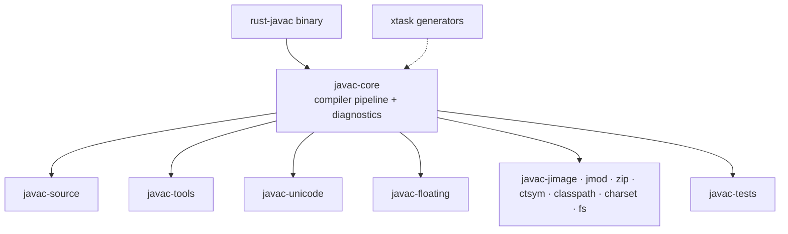
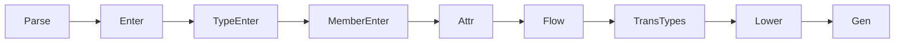

# Architecture

## Crate layout

## Compilation pipeline (aligned with javac)

- AST nodes are addressed by arena ids (`TypeId` / `SymbolId` / `TreeId`, see ADR 0001).
- Diagnostics are emitted through typed factories generated from
  `compiler.properties` (`resources/compiler_accessors.rs`). The message
  bundles live in `crates/javac-core/resources/l10n/` as `.properties`, are
  embedded with `include_str!`, and are parsed lazily by
  `resources/message_table.rs`.
- `-XDrawDiagnostics` is implemented in `util/raw_diagnostic_formatter.rs`.

## Resources

- `crates/javac-core/resources/l10n/*.properties` are the official JDK 17
  language bundles, embedded at build time (no runtime file I/O).
- `compiler_zh_CN.properties` carries 24 local patches that bring the
  Chinese coverage to 936/936.
- `cargo xtask gen-resources` regenerates the typed accessors
  (`compiler_accessors.rs`), the accessor metadata (`compiler_metadata.rs`),
  and the compatibility re-exports (`compiler_properties.rs`).