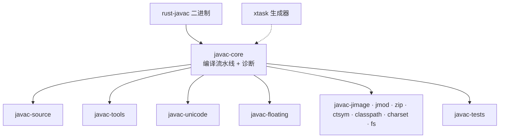
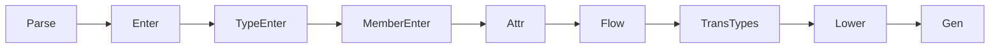

# 架构

## crate 分层

## 编译流水线（对齐 javac）

- AST 节点使用 `TypeId` / `SymbolId` / `TreeId` 的 arena id（ADR 0001）。
- 诊断通过从 `compiler.properties` 生成的类型化工厂发出（`resources/compiler_accessors.rs`）；消息原文以 `.properties` 形式放在 `crates/javac-core/resources/l10n/`，由 `include_str!` 嵌入，运行时由 `resources/message_table.rs` 惰性解析。
- `-XDrawDiagnostics` 由 `util/raw_diagnostic_formatter.rs` 支持。

## 资源

- `crates/javac-core/resources/l10n/*.properties` 是官方 JDK 17 语言包，使用 `include_str!` 嵌入（运行时无文件 IO）。
- `compiler_zh_CN.properties` 追加了 24 条本地补丁，使中文覆盖达到 936/936。
- `cargo xtask gen-resources` 重新生成类型化访问器（`compiler_accessors.rs`）、访问器元数据（`compiler_metadata.rs`）和兼容 re-export（`compiler_properties.rs`）。
